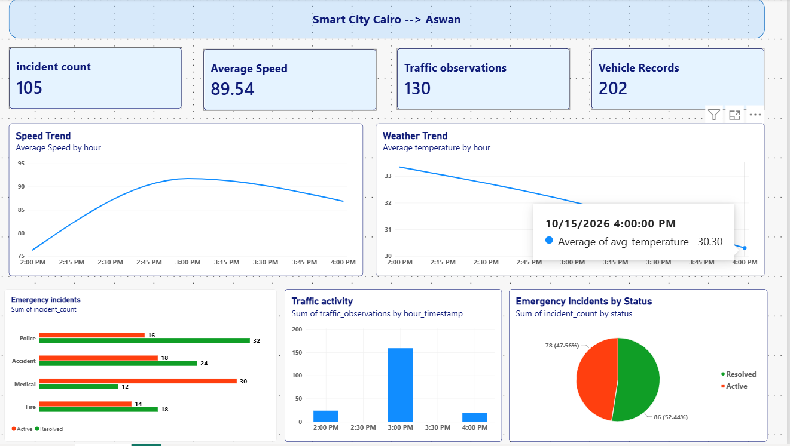

# Smart City Data Engineering Project

A data engineering project that simulates a smart city environment and processes vehicle, GPS, traffic, weather, and emergency data using a streaming pipeline.

The goal is to collect data from different sources, store it in a queryable format, and build analytical summaries that can be used in Power BI.

## Architecture

**Architecture diagram:** [View the architecture diagram(ADD_ARCHITECTURE_LINK_HERE)

## Dashboard

## Tech Stack

- **Python** — generating simulated smart city data
- **Apache Kafka** — streaming data through separate topics
- **Apache Spark Structured Streaming** — processing incoming streams
- **Amazon S3** — storing processed data in Parquet format
- **AWS Glue Data Catalog** — cataloging datasets
- **Amazon Athena** — querying data and creating analytical summary tables
- **SQL** — transforming raw datasets into curated tables using CTAS queries
- **Power BI** — visualizing the analytical results
- **Docker Compose** — running the local services

## Data Sources

The pipeline handles five types of data:

- Vehicle data
- GPS data
- Traffic observations
- Weather conditions
- Emergency incidents

## Pipeline Flow

1. Python generates simulated data for the five data sources.
2. Kafka publishes the records to separate topics.
3. Spark Structured Streaming consumes the topics and processes the incoming data.
4. The processed records are stored as Parquet files in Amazon S3.
5. AWS Glue Data Catalog makes the datasets available for querying.
6. Athena runs SQL queries to create analytical summary tables.
7. Power BI connects to Athena to visualize the results.

## SQL Queries

The Athena CTAS queries used to create the curated analytical tables are available in [`sql/athena_queries.sql`](sql/athena_queries.sql).

The queries create summary tables for:

- Vehicle statistics, including average and maximum speed
- GPS observations and speed by hour
- Traffic observations by hour, location, and camera
- Weather measurements and hourly averages
- Emergency incidents by type and status

The tables are stored in Amazon S3 in Parquet format and registered in the `smartcity` database.

## Dashboard Insights

The Power BI dashboard presents analytical views of the processed data, including:

- Average vehicle speed over time
- Traffic observations
- Weather trends
- Emergency incidents by status
- Summary KPIs

## Project Notes

The data is simulated and intended for learning and demonstration purposes. The project uses a single simulated vehicle journey, so the results should not be interpreted as real-world city traffic statistics.

The Power BI dashboard uses analytical summary tables created through Athena. These tables are snapshots and do not automatically refresh whenever new streaming data arrives.
